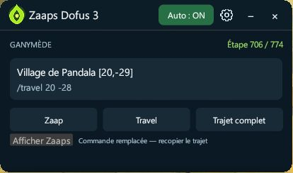
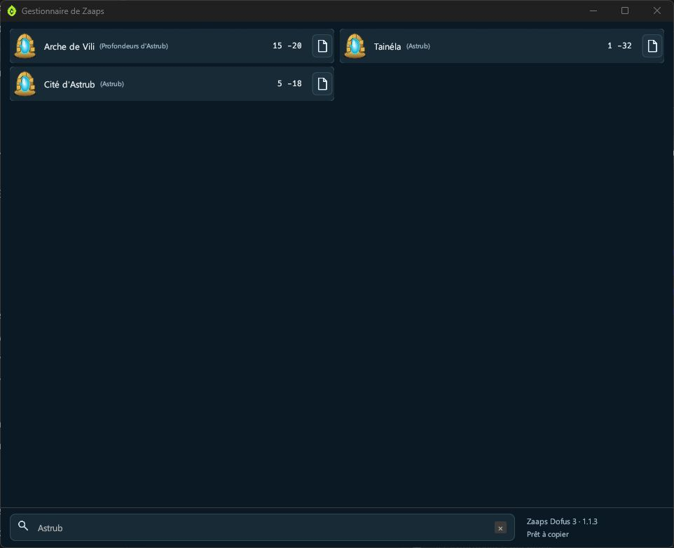
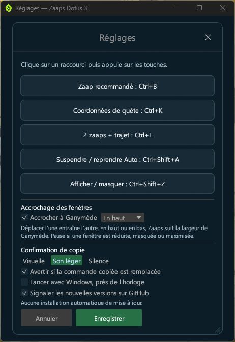
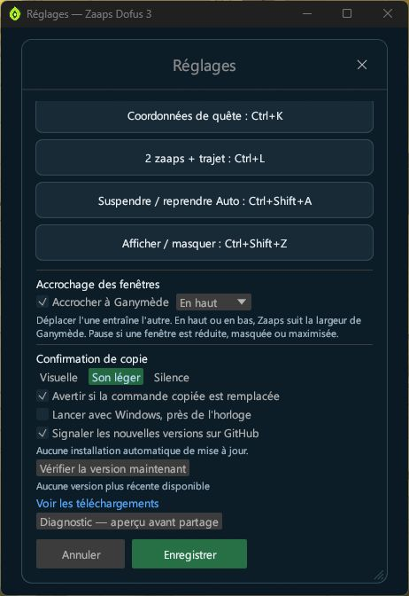

<p align="center">
  
</p>

<h1 align="center">Zaaps Dofus 3</h1>

<p align="center"><strong>Vos trajets Ganymède à portée de raccourci.</strong></p>

<p align="center">
  <a href="https://github.com/molow159-boop/zaaps-dofus3/releases/latest"></a>
  
  <a href="https://github.com/molow159-boop/zaaps-dofus3/actions/workflows/ci.yml"></a>
</p>

<p align="center">
  <a href="https://github.com/molow159-boop/zaaps-dofus3/releases/latest"><strong>Télécharger pour Windows</strong></a>
  &nbsp; · &nbsp;
  <a href="#prise-en-main">Prise en main</a>
  &nbsp; · &nbsp;
  <a href="docs/UTILISATION.md">Guide d'utilisation</a>
  &nbsp; · &nbsp;
  <a href="docs/COMPILATION.md">Compiler soi-même</a>
  &nbsp; · &nbsp;
  <a href="https://github.com/molow159-boop/zaaps-dofus3/issues">Signaler un problème</a>
</p>

Retrouvez un zaap, préparez votre déplacement et copiez votre trajet sans ressaisir les coordonnées. **Zaaps Dofus 3** est un utilitaire portable en Rust pour **Windows 10/11 x64**, conçu pour accompagner les étapes affichées dans **Ganymède**.

<p align="center">
  
</p>

Le compagnon reste discret à côté de Ganymède. **Afficher Zaaps** ouvre le gestionnaire dans une fenêtre séparée ; l'engrenage donne accès aux réglages.

## L'essentiel, dans une seule fenêtre

| Fonctionnalité | Au quotidien |
| --- | --- |
| **45 zaaps intégrés** | Parcourez la liste et copiez une commande en un clic. |
| **Recherche immédiate** | Retrouvez un zaap par son nom ou sa région. |
| **Trajets Ganymède** | Récupérez le Zaap recommandé et les coordonnées de destination. |
| **Cinq raccourcis configurables** | Choisissez vos touches pour les trois copies, Auto et l'affichage de la fenêtre. |
| **Mode automatique** | Copiez une fois le trajet à chaque nouvelle étape reconnue. |
| **Interface adaptable** | Redimensionnez librement la fenêtre ; les colonnes s'ajustent à sa largeur. |
| **Mode compact mémorisé** | Gardez seulement l'étape, le trajet et les boutons de copie ; dépliez la liste au besoin. |
| **Accrochage à Ganymède** | Placez Zaaps en haut, en bas ou sur un côté ; déplacer l'une entraîne l'autre. |
| **Icône près de l'horloge** | Réduisez la fenêtre en gardant la lecture de Ganymède et les raccourcis actifs. |
| **Presse-papiers surveillé** | Soyez averti si la commande copiée est remplacée et recopiez le trajet courant. |
| **Options de confort** | Confirmation visuelle, son ou silence ; démarrage avec Windows facultatif ; notification des nouvelles versions. |

## En images

| Gestionnaire indépendant | Recherche rapide |
| :---: | :---: |
| [](assets/screenshots/interface.jpg) | [](assets/screenshots/recherche.jpg) |
| La liste complète s'ouvre sans agrandir le compagnon accroché. | Filtrez par nom, région ou coordonnées. |

| Raccourcis et accrochage | Options de confort |
| :---: | :---: |
| [](assets/screenshots/reglages-raccourcis.jpg) | [](assets/screenshots/reglages-confort.jpg) |
| Exemple de touches personnalisées ; les raccourcis par défaut figurent ci-dessous. | Choisissez les confirmations et les fonctions à activer. |

## Prise en main

1. Dans la [dernière Release](https://github.com/molow159-boop/zaaps-dofus3/releases/latest), téléchargez **Zaaps-Dofus3-1.1.3-Windows-x64.zip** et extrayez entièrement l'archive.
2. Ouvrez Ganymède sur votre guide, puis lancez **Zaaps Dofus 3.exe**.
3. Cliquez sur un zaap ou utilisez un raccourci, puis collez la commande dans Dofus.

Pour garder le compagnon au premier plan de votre guide, ouvrez l'engrenage, activez **Accrocher à Ganymède**, choisissez le côté et enregistrez. Le bouton **Afficher Zaaps** reste disponible pour retrouver la liste.

**Aucune installation de Rust n'est nécessaire.** Le logiciel copie les commandes dans le presse-papiers ; vous gardez la main sur leur utilisation dans Dofus.

Le [guide d'utilisation](docs/UTILISATION.md) détaille les boutons, l'accrochage, Auto, les réglages et les mises à jour. Les **sources complètes** sont consultables ici dans le dépôt et disponibles dans **Zaaps-Dofus3-1.1.3-Sources.zip** sur la Release.

## Vos raccourcis

| Raccourci par défaut | Action |
| --- | --- |
| **Ctrl + J** | Copier le Zaap recommandé : `/zaap X,Y`. |
| **Ctrl + K** | Copier la destination : `/travel X Y`. |
| **Ctrl + L** | Copier le trajet complet disponible. |
| **Ctrl + Shift + A** | Suspendre ou reprendre le mode automatique. |
| **Ctrl + Shift + Z** | Afficher ou masquer la fenêtre. |

Ouvrez les réglages avec l'icône d'engrenage pour personnaliser les touches. Vos préférences sont conservées entre les lancements.

## Une présence discrète pendant vos guides

La vue compacte affiche le numéro d'étape reconnu, le Zaap et la destination. Les boutons **Zaap**, **Travel** et **Trajet complet** utilisent les mêmes données vérifiées que les raccourcis. Sans accrochage, **Afficher les 45 Zaaps** déplie la liste avec sa recherche ; **Revenir au mode compact** la replie. Le mode choisi est mémorisé.

Pour réunir les deux fenêtres, cochez **Accrocher à Ganymède** et choisissez **En haut**, **En bas**, **À gauche** ou **À droite**. Le côté décrit la position de Zaaps par rapport à Ganymède. Déplacer l'une déplace l'autre ; les bords visibles restent accolés, sans l'espace des bordures invisibles de Windows. En haut et en bas, Zaaps prend automatiquement la largeur de Ganymède : redimensionnez Ganymède pour ajuster cette largeur et les bords de Zaaps pour sa hauteur. Sur les côtés, le haut des fenêtres est aligné et Zaaps conserve sa taille compacte. La taille de Ganymède n'est pas modifiée par l'accrochage. L'option et le côté sont mémorisés ; décochez l'option pour séparer les fenêtres.

La vue accrochée se réduit automatiquement à environ **225 pixels de haut** : Auto, numéro d'étape, destination et trois boutons de copie. Le petit bouton **Afficher Zaaps** ouvre la liste et la recherche dans une fenêtre séparée, sans agrandir le compagnon. L'engrenage ouvre les réglages dans leur propre fenêtre ; le diagnostic y reste accessible.

L'accrochage est suspendu si l'une des fenêtres est masquée, réduite ou agrandie au maximum, puis reprend après restauration. Le groupe reste dans la zone utilisable de l'écran de la fenêtre déplacée. Si les deux fenêtres n'y tiennent pas, choisissez un autre côté ou réduisez leur taille. Si plusieurs fenêtres Ganymède sont reconnues, l'accrochage attend qu'une seule reste visible. L'option est désactivée par défaut.

Le bouton **−** réduit l'application près de l'horloge. Cliquez sur son icône pour la retrouver, ou utilisez **Ctrl+Shift+Z**. Le clic droit propose aussi la suspension d'Auto, la copie du trajet courant et **Quitter**. Le bouton **×** ferme complètement le logiciel. Si l'icône ne peut pas être créée, la réduction utilise la barre des tâches.

Dans les réglages, choisissez une confirmation **visuelle**, un **son léger** ou le **silence**. Les notifications visuelles respectent les paramètres de notification de Windows. La surveillance du presse-papiers ne restaure jamais une ancienne commande automatiquement : **Recopier le trajet courant** relit la destination actuellement reconnue.

Le **lancement avec Windows** est facultatif et désactivé par défaut. Activez-le après avoir placé l'exécutable à son emplacement définitif ; l'application démarrera réduite près de l'horloge. Si vous déplacez le dossier, enregistrez à nouveau les réglages pour actualiser cet emplacement.

La vérification de version consulte GitHub au lancement puis toutes les six heures, lorsqu'elle est activée. Elle affiche un lien vers une nouvelle Release stable sans télécharger ni installer de fichier automatiquement. Une vérification manuelle est disponible dans les réglages.

Le bouton **Diagnostic** ouvre un résumé modifiable de l'étape et des commandes reconnues. Il n'inclut ni le texte complet du guide ni le contenu remplacé du presse-papiers. Rien n'est envoyé automatiquement ; vérifiez l'aperçu avant de le copier et de le partager.

## Le bon trajet selon l'étape

Avec un Zaap et une destination, le trajet complet contient deux commandes `/zaap`, puis le voyage :

```text
/zaap 20,-29; /zaap 20,-29; /travel 24 -27
```

| Indications disponibles dans Ganymède | Résultat du trajet complet |
| --- | --- |
| Zaap réel et destination exploitable | Double `/zaap`, puis `/travel`. |
| Zaapi seul et destination exploitable | `/travel` uniquement ; le Zaapi est ignoré. |
| Destination exploitable sans Zaap | `/travel` uniquement. |
| Prochaine destination : Enutrosor, Srambad, Xélorium, Ecaflipus ou Osavora | Double `/zaap -20,-20`, puis `/travel -22 -24` vers la Tour des Voyageurs Dimensionnels. |
| Aucune destination exploitable | Aucune copie. |

Les noms usuels **Astrub, Bonta et Brâkmar** sont reconnus. Pour une prochaine destination dimensionnelle, les raccourcis préparent l'accès à la Tour : **Ctrl+J** copie son Zaap d'accès, **Ctrl+K** le voyage vers la Tour et **Ctrl+L** le trajet complet. Les coordonnées internes de la dimension ne sont pas utilisées dans le monde courant.

## Le mode automatique

Activez **Auto** pour copier le trajet à la prochaine nouvelle étape reconnue de Ganymède. Les données sont confirmées avant la copie et une même étape ne déclenche pas de copies répétées.

L'étape présente à l'activation sert de référence : elle n'est pas copiée automatiquement. Les raccourcis restent disponibles pour demander une commande manuellement.

<details>
<summary><strong>Données et compatibilité</strong></summary>

La liste des zaaps est intégrée à l'exécutable. Un fichier `zaaps.csv` placé à côté peut remplacer cette liste ; le modèle se trouve dans `assets/zaaps.csv`.

Les préférences sont enregistrées dans `%APPDATA%\Zaaps Dofus 3\raccourcis.ini`.

La détection dépend du texte accessible exposé par Ganymède. Les étapes incomplètes ou ambiguës sont refusées. Une dimension doit être annoncée comme prochaine destination après « Ensuite allez… » pour préparer l'accès à la Tour. Une simple mention dans l'action en cours ne déclenche pas cette redirection ; un trajet suivant clairement identifié avec son Zaap reste disponible. Sans compteur, deux étapes dont le texte est identique ne peuvent pas être distinguées.

L'exécutable n'est pas signé numériquement. Le fichier `SHA256.txt` de la Release permet de vérifier l'intégrité des téléchargements.

</details>

## Compiler depuis les sources

Prérequis : **Rust 1.99.1**, cible `x86_64-pc-windows-msvc`, Visual Studio Build Tools C++ et Windows SDK. Conservez le fichier `Cargo.lock` fourni.

```powershell
cargo fmt --all -- --check
cargo clippy --all-targets --locked -- -D warnings
cargo test --release --locked
cargo build --release --locked
```

Exécutable produit : `target\release\zaaps-dofus3.exe`.

Consultez le [tuto de compilation Windows](docs/COMPILATION.md) pour installer les prérequis et compiler pas à pas.

## Participer

Un problème de lecture ou une suggestion ? Ouvrez une [Issue](https://github.com/molow159-boop/zaaps-dofus3/issues) avec l'étape concernée et le résultat attendu. Pour contribuer, consultez [CONTRIBUTING.md](CONTRIBUTING.md). Les informations de sécurité figurent dans [SECURITY.md](SECURITY.md).

---

Code source sous [licence MIT](LICENSE). Ressources et marques : [NOTICE.md](NOTICE.md).

Projet communautaire indépendant, sans affiliation à Ankama ni à l'équipe Ganymède. DOFUS et Ganymède appartiennent à leurs ayants droit respectifs.
